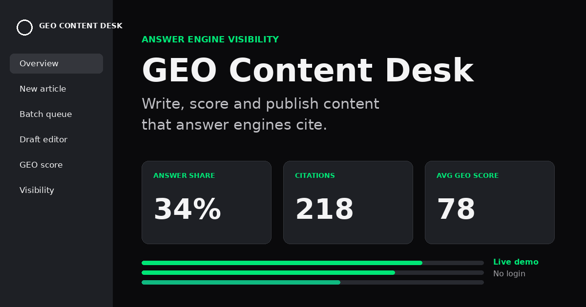

# GEO Content Desk

**A workspace for writing, scoring and publishing content that AI answer engines actually cite.**

**[Open the live demo](https://geo-content-desk.vercel.app/)** (no login, nothing to install)

---

## The problem

Your buyers have started asking ChatGPT, Perplexity, Claude and Google AI Overviews instead of scrolling through ten blue links. When an engine answers a question without quoting you, you do not exist for that buyer, however well your page ranks in classic search.

Most content teams run into the same three walls:

1. **They cannot see it.** There is no clear view of which buyer questions engines answer, who gets cited, and where the brand is missing.
2. **They write for ranking, not for extraction.** Engines lift a single clear passage into a generated answer. Long intros, unsourced claims and vague brand mentions rarely get quoted.
3. **There is no quality gate.** Drafts go live without anyone checking whether a passage is quotable, sourced and consistent with the brand voice.

## What GEO Content Desk does

Generative engine optimization (GEO) is the practice of structuring content so that answer engines quote it. GEO Content Desk turns that practice into a repeatable workflow, from finding the question to measuring the citation.

| Step | What happens |
| --- | --- |
| **1. Find the gaps** | Build a prompt library of the questions buyers ask, grouped into clusters, with monthly demand and your current coverage. Uncovered prompts surface first. |
| **2. Brief it** | Start from a guided wizard, a one-shot brief, a chat, a keyword workspace or your own uploaded sources. Choose format, length, entities to assert and the brand voice. |
| **3. Draft it** | Articles open each section with a direct, quotable answer block, assert the right entities and attribute every statistic to a source. |
| **4. Score it** | A GEO score rates quotability, sourcing, structure, entity coverage, freshness and prompt fit, then ranks recommendations by predicted lift. |
| **5. Gate and publish** | Apply suggestions in the editor and watch the score move. Publishing is blocked below a set threshold, needs human approval, and can inject FAQ and Article schema. |
| **6. Measure** | Track citations by engine, answer share, which articles earn them, and how long a new piece takes to get its first citation. |

## Inside the demo

- **Overview:** answer share by engine, prompt coverage gaps, drafts in flight
- **New article:** five ways to start a draft (wizard, brief, chat, keywords, your sources)
- **Batch queue:** many prompts drafting, scoring and staging in parallel
- **Draft editor:** live GEO score with one-click suggestions
- **GEO score:** single dial, dimension bars or section heatmap, plus ranked recommendations
- **Prompt library:** clusters, intent, demand and coverage, plus article templates
- **Publishing:** CMS destinations, schema injection and publish rules
- **Visibility:** citation trends, citation log and headline metrics
- **Brand voice:** tone dials, always-use and never-use words, guardrails
- **Team and usage:** roles, AI spend and token tracking

Try it: open the editor, apply the three AI suggestions and watch the score cross the publish gate.

## This is a demo

This page is a **front-end demo** built to show the product idea and workflow. Please read it that way:

- All clients, prompts, scores, citations and charts are **fictional sample data**.
- There is **no backend and no AI API** behind it. Generate, publish and invite buttons simulate the flow.
- It is a single HTML file with plain JavaScript, so it loads instantly and collects nothing.

## Want a real setup?

If you would like a working version for your brand or your clients, connected to your own data, brand voice and publishing stack, I am happy to talk it through.

**Manoj Kumar Gunasekaran**

- Email: [manojkumar.g.fr@gmail.com](mailto:manojkumar.g.fr@gmail.com)
- LinkedIn: [linkedin.com/in/manoj-kumar-g](https://www.linkedin.com/in/manoj-kumar-g)
